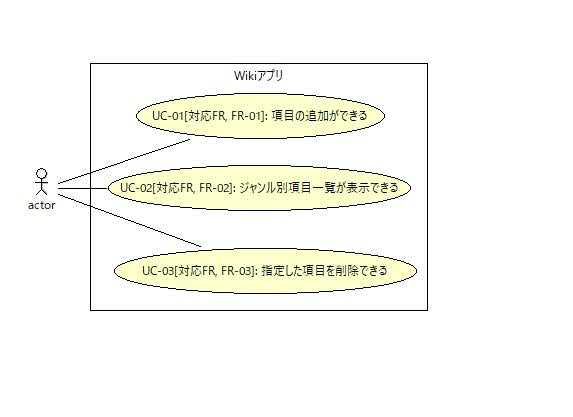

# イベントフロー

各ユースケースの具体的な業務フローを整理する。

定義されたUC一覧は、[ユースケース図](./diagrams/ユースケース図.ucd)参照。

### UC-01 項目の追加ができる

**基本フロー**
1. 利用者が項目追加を選択する
2. システムが項目追加画面を表示する
3. 利用者が項目のタイトル、説明文を入力し、ジャンルを選択して、追加ボタンをクリックする
4. システムが入力値チェックする
5. システムが追加した結果を返す

**代替フロー**
- 項目のタイトルまたは説明文が空なら、再度、項目追加画面を「必須項目が空です」というメッセージ付きで表示する

### UC-02 ジャンル別項目一覧が表示できる

**基本フロー**
1. 利用者がジャンルを選択し、一覧表示を選択する
2. ジャンル別一覧画面を表示する

**代替フロー**
- 選択したジャンルの項目が0件なら「項目がありません。項目を追加する」と表示する。項目を追加するはリンクで、選択すると UC-01 に遷移する。

### UC-03 指定した項目を削除できる

**基本フロー**
1. 利用者が項目削除を選択する
2. システムが項目削除画面を表示する
3. 利用者が項目を指定する
4. システムが指定された項目が存在するかチェックする
5. システムが削除した結果を返す

**代替フロー**
- 指定された項目がない場合、「指定された項目はありません」とダイアログで表示する